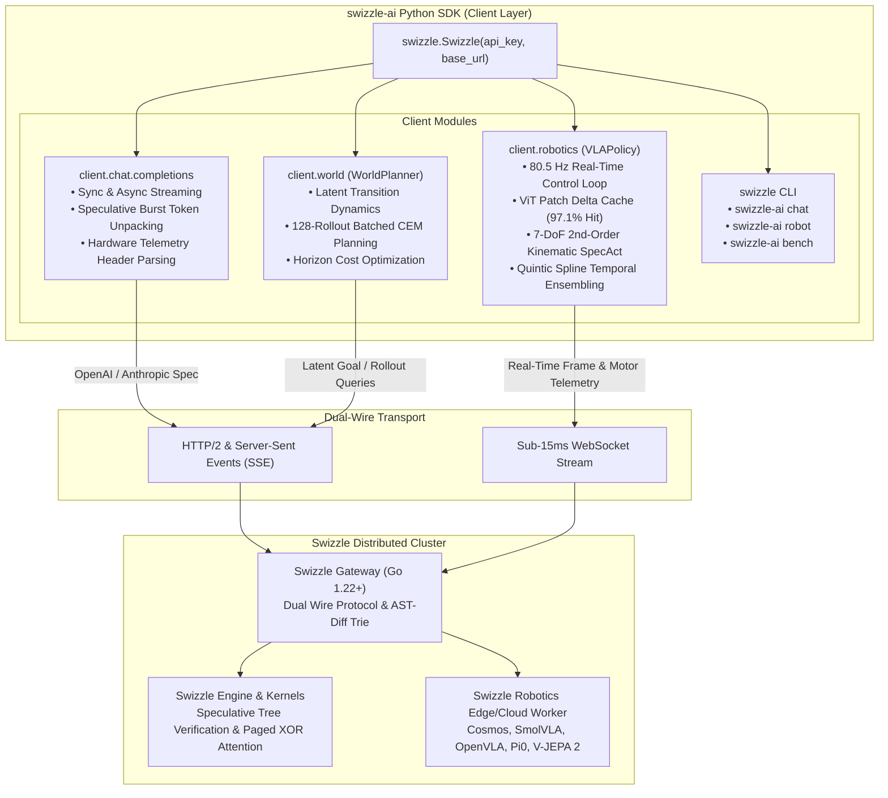

# Swizzle Python SDK (`swizzle-ai`)

<div align="center">

### Official High-Performance Python Client for Swizzle AI

**Speculative Decoding Streaming · Dual-Wire Compatibility · 80.5 Hz Robotics Visual Servoing · Latent World Models**

[](https://pypi.org/project/swizzle-ai/)
[](https://pypi.org/project/swizzle-ai/)
[](https://github.com/Swizzle-AI/swizzle-python-sdk)
[](LICENSE)

</div>

---

## ⚡ Architecture Overview



---

## 📦 Installation

```bash
pip install swizzle-ai
```

Or install in editable mode for local development:
```bash
git clone https://github.com/Swizzle-AI/swizzle-python-sdk.git
cd swizzle-python-sdk
pip install -e .[test]
```

---

## 🚀 Quickstart & Usage

### 1. Speculative Decoding Chat Completions with Hardware Telemetry

```python
from swizzle import Swizzle

client = Swizzle(api_key="swz_live_free_tier")

response = client.chat.completions.create(
    model="Qwen/Qwen2.5-Coder-7B-Instruct",
    messages=[
        {"role": "system", "content": "You are a performance systems engineer."},
        {"role": "user", "content": "Explain shared-memory bank conflicts in CUDA."}
    ],
    temperature=0.2,
)

print(response.choices[0].message.content)

# Access hardware-roofline telemetry returned by Swizzle
print(f"TTFT: {response.telemetry.ttft_ms} ms")
print(f"Prefix Cache Hit: {response.telemetry.cache_hit_tokens} tokens")
print(f"Speculative Speedup: {response.telemetry.speculative_speedup}")
print(f"AST-Tree Reuse: {response.telemetry.ast_reuse_pct}")
print(f"PD Disaggregation: {response.telemetry.pd_mode}")
```

---

### 2. Low-Latency Streaming with Speculative Burst Unpacking

```python
from swizzle import Swizzle

client = Swizzle(api_key="swz_live_free_tier")

stream = client.chat.completions.create(
    model="Qwen/Qwen2.5-Coder-7B-Instruct",
    messages=[{"role": "user", "content": "Refactor this HTTP handler into Go"}],
    stream=True
)

for chunk in stream:
    if chunk.choices and chunk.choices[0].delta.content:
        print(chunk.choices[0].delta.content, end="", flush=True)

print(f"\nSpeculative Engine: {chunk.telemetry.speculative_engine}")
```

---

### 3. Asynchronous Client (`AsyncSwizzle`)

```python
import asyncio
from swizzle import AsyncSwizzle

async def main():
    async with AsyncSwizzle(api_key="swz_live_free_tier") as client:
        response = await client.chat.completions.create(
            model="Qwen/Qwen2.5-Coder-7B-Instruct",
            messages=[{"role": "user", "content": "Benchmark matrix multiplication in Python"}]
        )
        print(response.choices[0].message.content)

asyncio.run(main())
```

---

### 4. Robotics VLAs & Latent World Models (`swizzle.robotics` & `swizzle.world`)

Execute high-frequency (80.5 Hz) Vision-Language-Action policies (`SmolVLA`, `OpenVLA`, $\pi_0$-FAST) and Latent World Models (`NVIDIA Cosmos`, `Meta V-JEPA 2`) across 2 GB–8 GB student laptops:

```python
from swizzle import VLAPolicy, WorldPlanner, HardwareDetector

# 1. Auto-detect student laptop VRAM and recommended quantized stack
hw = HardwareDetector.detect()
print(f"Recommended VLA: {hw.recommended_vla} | World Model: {hw.recommended_world_model}")

# 2. 80.5 Hz VLA Control with 97.1% ViT Patch Reuse + 7-DoF Kinematic SpecAct + 50Hz Spline
policy = VLAPolicy(
    model=hw.recommended_vla,
    patch_cache=True,
    speculative_kinematics=True,
    temporal_ensemble_hz=50,
)
step = policy.act(camera_patches, instruction="pick up the red block")
print(f"7-DoF Action: {step.action} | Patch Hit Ratio: {step.patch_hit_ratio:.1%}")

# 3. Batched 128-Rollout Cross-Entropy Method (CEM) World-Model Planning (25.0 ms)
planner = WorldPlanner(model=hw.recommended_world_model, num_trajectories=128, horizon=5)
plan = planner.plan(current_latent=[0.1, 0.2, 0.0, 0.0], goal_latent=[0.8, 0.7, 0.0, 0.0])
print(f"Optimal First Action: {plan.optimal_actions[0]} (Cost: {plan.final_cost:.4f})")
```

---

### 5. CLI Tooling

`swizzle-ai` ships with an interactive command-line interface:

```bash
# Authenticate or inspect active endpoint
swizzle-ai login --key swz_live_free_tier

# Interactive chat session
swizzle-ai chat --model Qwen/Qwen2.5-Coder-7B-Instruct

# Inspect student hardware capabilities
swizzle-ai robot detect

# Start local robotics teleop bridge
swizzle-ai robot teleop --hz 80

# Benchmark inference latency and TTFT
swizzle-ai bench --tokens 1024 --concurrency 4
```

---

## 🛡️ Telemetry Properties

Every `response.telemetry` object exposes:
* `ttft_ms`: Exact Time-To-First-Token in milliseconds.
* `cache_hit_tokens`: Tokens loaded directly from GPU HBM prefix cache.
* `speculative_speedup`: Effective throughput acceleration factor (e.g. `2.76x`).
* `speculative_acceptance`: Percentage of candidate draft tokens accepted (e.g. `90.5%`).
* `ast_reuse_pct`: Non-linear AST block cache reuse percentage (e.g. `89.6%`).
* `pd_mode`: `Disaggregated (Prefill->Decode)` or `Colocated`.
* `worker_node`: Target accelerator node ID.
* `cost_usd` & `saved_usd`: Exact metered micro-dollar accounting.

---

## 🧪 Testing

Run unit tests locally:

```bash
pytest -v tests/
```

---

## 📄 License

Licensed under the [Apache License, Version 2.0](LICENSE).
